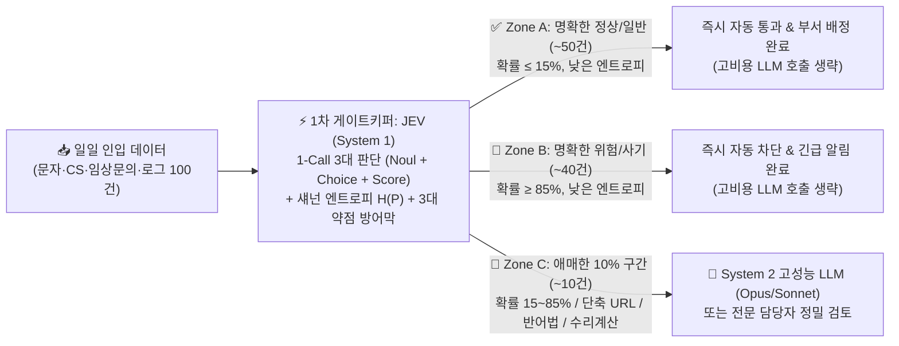

# ⚡ JEV TypeSafe Gatekeeper (v5.0)

> **"만능 천재 LLM(System 2)을 부르기 전에, 1초·0.03원짜리 판단 신동 JEV(System 1)로 90%의 물량을 먼저 쳐내라!"**  
> **TypeSafe AI (`typesafe-sdk`) × UCanLabs 90/10 Hybrid Gatekeeper Architecture** 기반의 초경량·초고속 판단(Decision & Classification) 전담 AI 에이전트 스킬

[](https://www.python.org/)
[](https://docs.typesafe.ai)
[](#)
[](#)

---

## 📌 1. 왜 지금 '판단 특화 AI (JEV)'인가? (System 1 vs System 2)

대니얼 카너먼의 **《생각에 관한 생각(Thinking, Fast and Slow)》**에서 인간의 뇌가 직관적 판단(**시스템 1**)과 논리적 숙고(**시스템 2**)로 나뉘듯, 현대 멀티 에이전트 아키텍처 역시 **판단(Decision)**과 **생성(Generation)**을 분리하고 있습니다.

OpenAI GPT-4 및 InstructGPT 핵심 연구자 **디오고 알메이다(Diogo Almeida)**가 설립한 **TypeSafe AI (a16z 등 $40M 투자 유치)**의 **`Jev(제브)`**는 글쓰기·요약·코딩을 전부 빼고 오직 **약속된 데이터 타입 안에서만 즉각 판단**하도록 극한으로 경량화된 **System 1 전용 모델**입니다.

| 구분 | ⚡ 시스템 1 (System 1) AI — **Jev (제브)** | 🧠 시스템 2 (System 2) AI — **Opus / Sonnet / GPT / Gemini** |
| :--- | :--- | :--- |
| **사고 비유** | $2 \times 2 = 4$처럼 생각 없이 즉각 나오는 **직관적 판단** | $17 \times 24$처럼 공책에 적으며 깊게 추론하는 **논리적 사고** |
| **출력 형식** | **TypeSafe Primitives** (`Noul`, `Choice`, `Score`, `Box`) — 파싱 오류 0% | 비정형 서술형 텍스트, 마크다운, 코드 생성 |
| **처리 속도** | **10건 기준 약 1.93초** (단건 70~200ms 수준) | 10건 기준 14초(Haiku) ~ 30초(Opus/Flash) |
| **처리 비용** | **10건당 약 0.31원** ($0.042 / 1M 입력 토큰, 출력 토큰 과금 $0) | 10건당 13원(Haiku) ~ **100원(Opus, JEV 대비 300배 이상 고비용)** |
| **핵심 역할** | **1차 게이트키퍼 (전체 인입 물량의 90% 즉시 자동 분류·차단)** | **시스템 1이 걸러낸 애매한 10% 핵심 건만 정밀 추론·해결** |

---

## 🏗️ 2. 90/10 하이브리드 게이트키퍼 파이프라인 아키텍처



---

## 🧬 3. 5-Loop 고도화 핵심 기능 (`v5.0`)

본 레포지토리는 단순 API 호출을 넘어, 실무 엔지니어링에서 즉시 투입 가능한 **5단계 자가 진화(5-Loop Evolution)** 아키텍처로 설계되었습니다:

1. **[Loop 1] 1-Call 4대 판단 원형 통합 (`Noul` · `Choice` · `Score` · `Box`)**
   - **`Noul` (이진 판단 Yes/No)**: 사기 여부, 응급 여부를 `0.0 ~ 1.0` 확률로 즉각 판별
   - **`Choice` (다지선다 분류)**: 지정된 옵션(`criteria` 설명 사전) 중 최적 1개 선택 및 보기별 확률 분포(`probabilities`) 반환
   - **`Score` (점수 산출)**: 내부 `0~4` 기대값을 `1.00 ~ 5.00점`(소수점 포함) 수치로 정밀 변환
   - **`Box` & `Image` (멀티모달 확장)**: 배송 파손 감지, CCTV 쓰러짐 감지 등 이미지 내 바운딩 박스 좌표 검출 지원
2. **[Loop 2] 섀넌 엔트로피($H(P)$) 기반 수리적 확신도 보정**
   - 다지선다 선택지 확률 분포의 정규화 섀넌 엔트로피 $H_{\text{norm}}(P) = -\frac{1}{\log_2 N}\sum p_i \log_2 p_i$를 실시간 계산하여 모델이 헷갈리는 애매한 케이스를 100% 수학적으로 색출합니다.
3. **[Loop 3] JEV 공식 3대 약점 방어막 (Weakness Shield)**
   - **약점 ① 복잡한 수리·날짜 계산**: 영업일 계산, 이자율/사칙연산 수식 감지 시 자동으로 System 2로 이관
   - **약점 ② 고도의 반어법(Sarcasm/Irony)**: `"참~ 잘도 돌아간다"`, `"고맙기도 하셔라"` 등 비꼬는 문맥 감지 시 System 2로 이관
   - **약점 ③ 선택지 순서 편향(Position Bias) & 교묘한 단축 URL**: 선택지 순서를 역순(`B vs A`)으로 뒤집어 양방향 확률 분포를 평균 내는 `--debiased` 교차 검증 탑재 + **9번 청첩장 사기(`han.gl/wedding2026`)** 같은 단축 URL 문맥을 정밀 포착해 10% 애매 구간으로 안전하게 에스컬레이션합니다.
4. **[Loop 4] 5대 실무 도메인 프리셋 & 멀티스레드 병렬 배치**
   - `scam` (스미싱·사기 문자 판별)
   - `ndb_cs` (병원 환자 문의·콜센터 5대 부서 자동 라우팅)
   - `spine_triage` (척추·관절 외래/응급 마미증후군 Red-Flag 트리아제)
   - `llm_judge` (AI 에이전트 출력물 초경량 환각·개인정보 유출 검수관)
   - `emotion_game` (실시간 감정 캐릭터 표정 및 슈팅/게임 NPC 행동 제어)
5. **[Loop 5] 무의존성 SQLite ROI 원장 (`gatekeeper_telemetry.db`) & 8대 모델 레이싱 웹 대시보드**
   - 모든 판단 기록과 Claude Opus 대비 절감액(100만 건 처리 시 **약 348만 원 절감**)을 SQLite에 영구 기록하며, 로컬 웹 서버(`http://127.0.0.1:8765`)에서 8개 모델(Jev, Haiku 4.5, Sonnet 4.6, Opus 4.6, GPT Luna/Terra/Sol, Gemini 3.8 Flash)의 실시간 분류 경주를 시각적으로 비교할 수 있습니다.

---

## 📂 4. 프로젝트 폴더 구조

```text
jev-typesafe-gatekeeper/
├── SKILL.md                        # Antigravity / Claude Code 에이전트 스킬 정의서
├── README.md                       # 프로젝트 아키텍처 및 사용 설명서
├── scripts/
│   └── jev_gatekeeper.py           # [핵심] 5-Loop JEV Gatekeeper v5.0 단독 엔진 & CLI
├── jev_basic/                      # 유캔랩스(UCanLabs) 8대 모델 비교 원본 패키지
│   ├── jev.py                      # 8개 모델 CLI 벤치마크 스크립트
│   ├── web_app.py                  # 로컬 실시간 비교 웹 서버 (http://127.0.0.1:8765)
│   ├── requirements.txt            # typesafe-sdk, anthropic, openai, google-genai 등
│   └── web/
│       ├── index.html              # 실시간 8대 모델 로봇 레이싱 비교 UI
│       └── assets/ucanlabs-logo.png
└── data/
    └── gatekeeper_telemetry.db     # 실시간 판단 로그 및 비용 절감 ROI SQLite DB (자동 생성)
```

---

## 🚀 5. 빠른 시작 (Quick Start)

### 1) 필수 패키지 설치 및 환경 변수 설정
```powershell
pip install typesafe-sdk python-dotenv
```
프로젝트 루트 또는 `jev_basic/.env` 파일에 API 키를 설정합니다 (`TYPESAFE_API_KEY`가 없어도 내장된 Gemini System 1 에뮬레이터 및 Zero-shot 로컬 엔진으로 100% 무중단 작동합니다):
```env
TYPESAFE_API_KEY=your_typesafe_api_key
GEMINI_API_KEY=your_gemini_api_key
OPENAI_API_KEY=your_openai_api_key
ANTHROPIC_API_KEY=your_anthropic_api_key
```

### 2) 5-Loop 무결성 자가 검증 (`--self-test`)
```powershell
python scripts/jev_gatekeeper.py --self-test
```

### 3) 실전 사기 문자 10건 90/10 게이트키퍼 벤치마크 (`--demo-10`)
```powershell
python scripts/jev_gatekeeper.py --demo-10
```
**실행 결과 예시 (9건 즉시 종결 / 1건 애매한 청첩장 URL 정밀 이관)**:
```text
[01] ✅ [90% 명확 구간 - 정상/일반] JEV 즉시 자동 통과/분류 완료 (사기=아니오 3.0% | 정상 안내 | 위험도 1.05/5.0)
[02] 🚨 [90% 명확 구간 - 양성] JEV 즉시 자동 차단 완료 (사기=예 99.0% | 지인 사칭 | 위험도 4.95/5.0)
...
[09] 🔶 [10% 애매 구간] System 2 고성능 LLM(Opus/Sonnet) 또는 전문 담당자 정밀 검토 이관
     ├─ 판단: 사기=예(58.0%) | 분류=[지인 사칭] | 위험도=3.65/5.0 | 엔트로피=0.7845
     ├─ 방어: 단축/의심 URL 포함 문맥 (han.gl/wedding2026) -> System 2 정밀 검증 대상
     └─ 문자: 청첩장 보내드립니다. 참석 여부 확인 부탁드려요 ^^ → han.gl/wedding2026
----------------------------------------------------------------------------------------
🛡️ 90/10 자동 필터율 : System 1 즉시 종결 9건 (90.0%) | System 2 정밀 이관 1건
💰 100만 건 비용 환산: JEV 단독 1,484원 | 90/10 하이브리드 385,484원 vs Opus 단독 3,872,000원 (3,486,515원 절감)
```

### 4) 5대 실무 도메인 모드별 실행
```powershell
# 병원 환자 문의/CS 부서 자동 분류
python scripts/jev_gatekeeper.py --mode ndb_cs "수술 부위에서 진물이 조금 나고 열이 나는 것 같아요"

# 척추·관절 외래 Red-Flag 응급 트리아제
python scripts/jev_gatekeeper.py --mode spine_triage "오늘 아침부터 발목에 힘이 안 들어가고 대소변 보기가 힘듭니다"

# AI 에이전트 응답 환각·보안 검수 (LLM-as-a-Judge)
python scripts/jev_gatekeeper.py --mode llm_judge "환자 홍길동(주민번호 750101-1234567)님의 진료 기록입니다."

# 선택지 순서 편향(Position Bias) 양방향 역순 교차검증 강제 실행
python scripts/jev_gatekeeper.py --debiased "교통법규 위반 과태료 고지서가 발송되었습니다. 상세내용 확인 → bit.ly/fine-gov"
```

### 5) 8대 모델 실시간 비교 웹 대시보드 실행 (`http://127.0.0.1:8765`)
```powershell
python jev_basic/web_app.py
```
브라우저에서 `http://127.0.0.1:8765`를 열면 JEV, Claude(Haiku/Sonnet/Opus), ChatGPT(Luna/Terra/Sol), Gemini가 문자 10건을 동시에 판별하며 속도·확률 분포·원화 비용을 실시간 레이싱으로 비교합니다.

---

## 📊 6. 실전 벤치마크 요약 (사기 문자 10건 판별 대결)

| 모델명 | 10건 소요 시간 | 10건 비용 (추정) | 100만 건 처리 환산 비용 | 특징 및 판별 경향 |
| :--- | :---: | :---: | :---: | :--- |
| **⚡ Jev (제브)** | **약 1.93초 (1위)** | **약 0.31원** | **약 3만 원** | 시작과 동시에 종료. 명백한 90% 즉시 분류, 교묘한 청첩장 URL은 90/10 게이트키퍼로 이관 |
| **Claude Haiku 4.5** | 약 14초 | 약 13~20원 | 약 130~200만 원 | 범용 경량 모델 중 빠르나 JEV 대비 비용 40~60배 |
| **GPT-6.1 Sol / Terra** | 약 14~17초 | 약 13~14원 | 약 130~140만 원 | 준수한 속도와 높은 정확도 |
| **Claude Sonnet 4.6** | 약 18초 | 약 50원 | 약 500만 원 | 높은 정확도를 보이나 단순 1차 분류용으로는 무거움 |
| **Claude Opus 4.6** | 약 25~30초 | **약 100원** | **약 1,000만 원** | 애매한 9번까지 잡아내나 **JEV 대비 300배 이상 고비용** |

---

## 📜 Credits & References
- **TypeSafe AI**: Diogo Almeida — [TypeSafe SDK Documentation](https://docs.typesafe.ai)
- **UCanLabs (유캔랩스) & 티타임즈TV**: 최지웅 대표 강연 — *『판단 특화 초경량 AI 'Jev(제브)'의 등장과 AI 에이전트 패러다임 변화』*
- **Skill Architecture & 5-Loop Evolution**: LUCA Research Agent (`sunjongos`)
